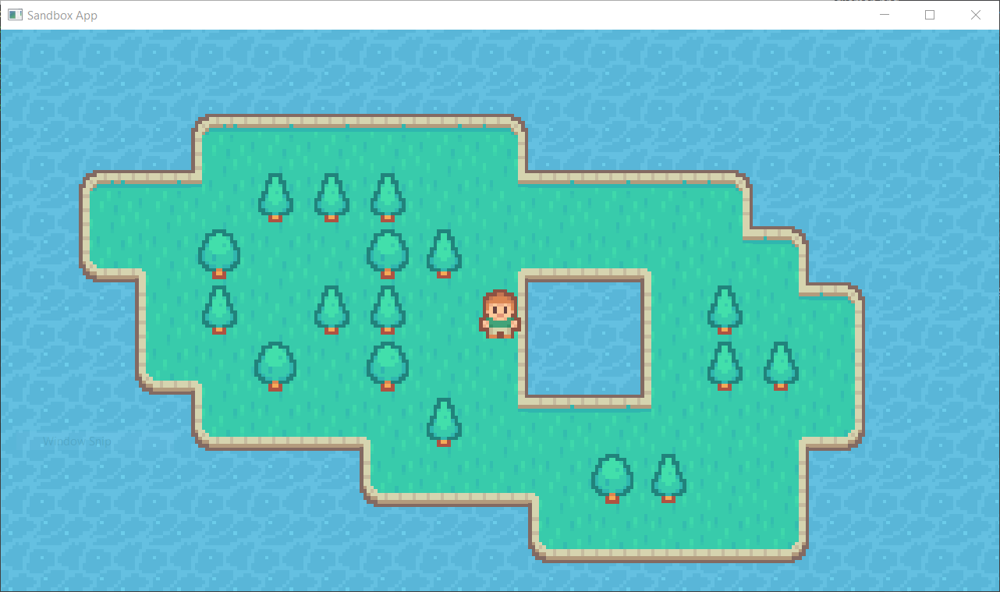
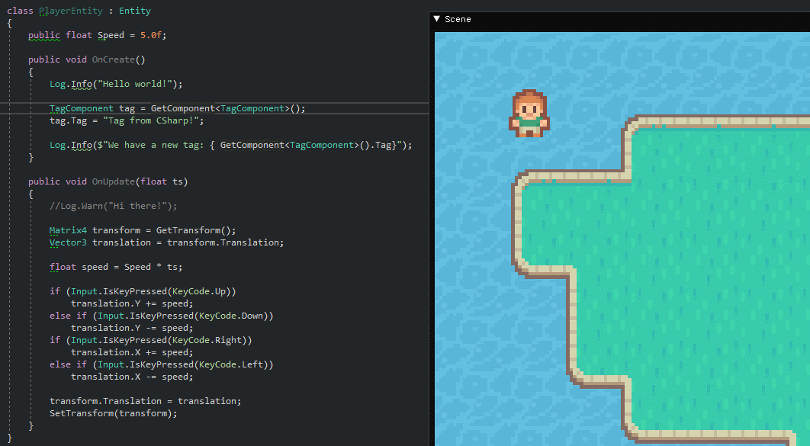
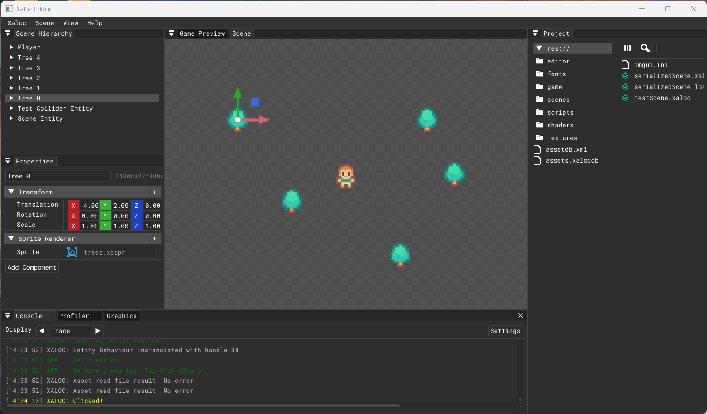

<h1 align="center" style="border-bottom: none;">
  <a href="https://github.com/pacojq/Xaloc/">Xaloc Engine</a>
</h1>

  

> Sirocco (Catalan: _Xaloc_).
> 
> From arabic, _shaluq_ 'wind from the sea' .
> 
> A Mediterranean wind that comes from the Sahara and can reach hurricane
> speeds in North Africa and Southern Europe, especially during the summer
> season.

## About

Xaloc is an in-development 2D game engine written in C++, allowing an ECS
approach and C# scripting.

I develop it in my spare time as a personal project, so expect frequent
periods of time with no activity in this repository.

    

## Set up

Xaloc Engine is built in a Windows environment, using **Visual Studio 2022**.

We use **Premake5** to generate solution and project files. You can execute
the script `scripts/Win-GenProjects.bat` to setup the VS2022 solution.

### .NET Framework 

In order to build Xaloc, you will need to have the .NET Framework SDK
installed. The engine's C# scripting module targets .NET Framework 4.7.2.

## Compiling and Executing

The default startup project is the `Sandbox` App.

Remember to build the **entire solution** if you modify the C# files in
`SandboxCs`, since the `.dll` file for the scripting project is generated
apart from the main Sandbox application.

    

## Current Features

Right now, Xaloc is very bare-bones. Its most remarkable features are:

| Feature | Description | Status |
| ------- | ----------- | ------ |
| **Scene system** | Scene-based entity management. Scene serialization with XML. | Done✔️ |
| **ECS support** | Entity Component System approach through *entt*. Sort list of components, including `TransformComponent`, `SpriteRenderer`, `TagComponent` and `BehaviourComponent`. | Done✔️ |
| **C# scripting** | Basic scripting in C# using mono. | Done✔️ |
| **2D Renderer** | 2D batch renderer supporting OpenGL. | Done✔️ |
| **ImGui support** | Basic game editor and in-game debug UI using ImGui. | Done✔️ |
| **Asset manager** | Basic asset handling API. | Done✔️ |
 

## Planned Features

| Feature | Description | Status |
| ------- | ----------- | ------ |
| **Better asset manager** | Packaging assets, streaming, etc. | WIP 💻 |
| **Audio system** | Sound API. | TODO 📋 |
| **Physics system** | Own 2D physics API. | TODO 📋 |
| **Font support** | Extend the Renderer capabilities so it can draw text. | TODO 📋 |

The game editor is in continuous development.

    

## Dependencies

Xaloc has the following dependencies:

  - [ImGui](https://github.com/ocornut/imgui) and [ImGuizmo](https://github.com/CedricGuillemet/ImGuizmo) for GUI rendering.
  - [ImPlot](https://github.com/epezent/implot) as plotting library for the profiler.
  - [mono](https://www.mono-project.com/docs/about-mono/) for C# [scripting](https://www.mono-project.com/docs/advanced/embedding/scripting/).
  - [GLFW](https://github.com/glfw/glfw) for OpenGL, OpenGL ES, window creation 
  and input handling. More info at its [website](https://www.glfw.org/).
  - [Glad](https://glad.dav1d.de) for OpenGL rendering.
  - [glm](https://github.com/g-truc//glm) as math(s) library.
  - [entt](https://github.com/skypjack/entt) for ECS management.
  - [spdlog](https://github.com/gabime/spdlog) for logging.
  - [stb_image.h](https://github.com/nothings/stb) for loading textures.
  - [pugixml](https://pugixml.org) for scene serialization in XML.

Projects are generated with [Premake 5](https://github.com/premake/premake-core/releases).

## Special Mentions

Huge shout out to:

  - Yan Chernikov's [video series](https://www.youtube.com/playlist?list=PLlrATfBNZ98dC-V-N3m0Go4deliWHPFwT). Original code at [TheCherno/Hazel](https://github.com/TheCherno/Hazel).
  - Jason Gregory's [Game Engine Architecture](https://www.gameenginebook.com) book.
